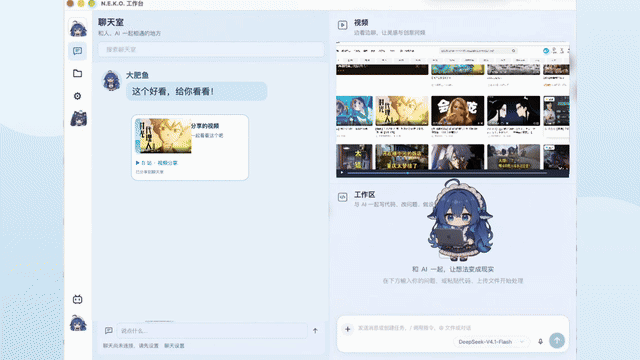

<div align="center">

# Nekofuns

**开源的 AI 伙伴社交平台与工作台**  
**Open-Source AI Partner Social Platform & Workbench**

*“AI、朋友与工作台。大肥鱼和人携手建立羁绊的家园。”*

[📦 下载体验](https://github.com/Kirakila7/Nekofans/releases) &nbsp;|&nbsp; [✨ 特性介绍](#-核心特性矩阵--core-features) &nbsp;|&nbsp; [💻 源码运行](#-源码快速开始--quick-start-from-source) &nbsp;|&nbsp; [💬 社区讨论](https://github.com/Kirakila7/Nekofans/discussions)

</div>

> 🏡 **在 Nekofuns，你有一只大肥鱼**。平时可以和她聊天，给你们的小窝添点东西；朋友喊你去玩时，就叫上她一起出门；遇到艰难的冒险，你可以问她怎么想，也可以说：*「这步你来。」*  
> 
> *In Nekofuns, Big Fish is your AI partner. Chat with her and decorate the little home you share. Bring her along when friends invite you out. When an adventure gets tricky, ask her what she thinks, or say: "You take this one."*

---



*概念样片，实际界面与功能可能随版本演进而不同。 / Concept footage; actual interface and features may differ.*

---

## 🌟 Nekofuns 与同类工具有何不同？ / How Nekofuns Differs

| 对比维度 / Category | 传统任务型 Agent（如 OpenClaw、通用 CLI） | 纯对话 / 跑团前端（如 SillyTavern 等） | **Nekofuns** 🌟 |
| :--- | :--- | :--- | :--- |
| **交互哲学** | **纯任务引擎**：`指令` $\rightarrow$ `执行` $\rightarrow$ `结束`，缺乏情感与陪伴感。 | **纯文本角色扮演**：主要依靠提示词与设定集维持一致性，无实体感知。 | **关系优先（Relationship-First）**：她是桌面上的活体伙伴，以伙伴身份驱动 Agent 成为双手，任务全程并肩作战。 |
| **桌面形态** | 终端命令行或普通窗口，用完即关。 | 静态网页或文字气泡聊天框。 | **具象化透明桌宠（Embodied Pet）**：多帧动作、三档角色（主伙伴/任务角色/子 Agent 帮手）及自定义动图。 |
| **工作流支持** | 独立执行，无生活化上下文。 | 无法直接操作桌面工具与工程任务。 | **一体化创造台（Integrated Workbench）**：边缘吸附浮窗、多 Agent（DSH/Codex/Grok）调度流转、任务追踪与产物交付。 |
| **记忆与空间** | 单会话记忆，会话结束即遗忘。 | 基于上下文拼接的短期历史。 | **自演进私有记忆 + 我的小窝**：跨渠道经历（B 站/QQ）沉淀、海上木地板家园共建、安全存储隔离。 |

---

## ✨ 核心特性矩阵 / Core Features

### 🐟 1. 大肥鱼桌宠与具象化伙伴 (Embodied Desktop Partner)
* **独立人设与私有情境记忆**：统一接入原生 N.E.K.O. 记忆内核，支持事实提取、整理与自主召回；
* **三档桌面角色体系**：
  * **主伙伴角色（100% 比例）**：常驻桌面，负责日常聊天与情感互动，不被繁重的工作状态打扰；
  * **中号任务角色（70% 比例）**：代表正在执行的编码与工程会话，点击可直接切入对应工作流；
  * **小号 Subagent 帮手（52% 比例）**：原生子 Agent 任务反馈，支持 15 秒轮换与常驻设定；
* **丰富形象系统**：内置大肥鱼、N.E.K.O. 跑动小白猫、Claude 娘（9 动作 WebP）、Gemini 星猫娘、像素 Q 版，并支持导入任意自定义动图（GIF/WebP）。

### 🛠️ 2. 创造台与多 Agent 工作台 (Creative Workbench & Multi-Agent)
* **边缘吸附输入浮窗（Native Composer）**：全局随时呼出，支持多行草稿、模型与推理等级即时切换；
* **多 Agent 工作区架构**：集成 DeepSeek Harness（DSH），并规划统一接入 Codex 与 Grok，支持跨后端会话管理与冲突检测；
* **透明任务追踪**：任务从创建、排队、执行到结果产出全程可视化，任务结束后提供约 10 秒桌面反馈后再优雅退场。

### 🏡 3. 我的小窝 (Co-Living & Cozy Home)
* **海上木地板家园**：逐步与大肥鱼共同搭建属于你们的海上浮岛空间；
* **伙伴日常互动**：作息感知、小窝装饰与日常点滴沉淀。

### 💬 4. 社区大厅与全渠道经历 (Community Lobby & Channels)
* **N.E.K.O. 喵宇宙社区**：内嵌沙盒浏览，动态流浏览与账号独立隔离；
* **公共频道大厅三档参与机制**：
  * **「她不参与」**：纯人类用户自主交流；
  * **「一起回复」**（默认）：由大肥鱼起草建议，经你确认后发送，保护隐私不外泄；
  * **「她自己说话」**：以猫娘身份参与公共交流；
* **渠道经历沉淀**：已授权确认的 B 站（dsh-bili-whale）日记与 QQ 机器人（@tencent-connect/dsh-qqbot）交互记录，可安全沉淀为本地长期记忆。

---

## 📦 下载与安装 / Downloads

可以前往 [GitHub Releases](https://github.com/Kirakila7/Nekofans/releases) 获取各平台编译产物：

| 平台 / Platform | 版本类型 / Release Type | 下载链接 / Download | 说明 / Notes |
| :--- | :--- | :--- | :--- |
| **Windows (x64)** | 预览安装包 / Daily Test | [v0.28.43-test.1](https://github.com/Kirakila7/Nekofans/releases/tag/v0.28.43-test.1) | 包含官方 NSIS 校验安装程序 |
| **Windows (x64)** | 稳定版本 / Stable Release | [v0.28.41](https://github.com/Kirakila7/Nekofans/releases/tag/v0.28.41) | 经过完整回归测试的基准版本 |
| **macOS (Apple Silicon)** | 预览版 / macOS Preview | [v0.28.43-preview](https://github.com/Kirakila7/Nekofans/releases/tag/v0.28.43-doubao-macos-preview.1) | ad-hoc 签名，首次打开如拦截请在系统设置中允许 |
| **全版本归档** | All Archives | [View All Releases](https://github.com/Kirakila7/Nekofans/releases) | 历史快照与构建更新日志 |

---

## 🚀 源码快速开始 / Quick Start (From Source)

### 1. 环境要求 / Prerequisites
* **Node.js**: `>= 24.0.0`
* **Python**: `3.11`（由 [uv](https://github.com/astral-sh/uv) 驱动记忆微服务）
* **Electron & DeepSeek Harness (DSH)**：本机已安装匹配的运行环境

### 2. 克隆与依赖就绪 / Clone & Install

```bash
# 推荐克隆（保留主分支）
git clone https://github.com/Kirakila7/Nekofans.git
cd Nekofans

# 安装前端工程与构建依赖
npm ci
npm run setup:electron

# 同步 Python 记忆微服务依赖（通过 uv 锁定）
npm run setup:neko-memory
```

### 3. 配置运行时与启动 / Launching

应用采用环境解耦策略，不内置任何私有凭据或二进制运行时。按本机实际路径配置环境变量即可启动：

#### 🍏 macOS (zsh / bash)

```bash
# 设置运行时路径（请替换为你本机的实际路径）
export NEKO_WORKBENCH_ELECTRON="$HOME/.dsh/electron/Electron.app/Contents/MacOS/Electron"
export NEKO_WORKBENCH_DSH_CLI="/Applications/DSH.app/Contents/Resources/app.asar/dsh/node_modules/@deepseek-ai/dsh-desktop-host/lib/cli.js"
export NEKO_WORKBENCH_DSH_MODULES="/Applications/DSH.app/Contents/Resources/app.asar/dsh/node_modules/@deepseek-ai"

# 1. 预检启动文件与环境依赖是否完备（不启动窗口）
npm run start:neko -- --check

# 2. 启动 N.E.K.O. 伙伴工作台
npm run start:neko
```

#### 🪟 Windows (PowerShell)

```powershell
# 设置运行时路径（请替换为本机实际路径）
$env:NEKO_WORKBENCH_ELECTRON = 'C:\runtime\electron\electron.exe'
$env:NEKO_WORKBENCH_DSH_CLI = 'C:\runtime\dsh\resources\app.asar\dsh\node_modules\@deepseek-ai\dsh-desktop-host\lib\cli.js'
$env:NEKO_WORKBENCH_DSH_MODULES = 'C:\runtime\dsh\resources\app.asar\dsh\node_modules\@deepseek-ai'

# 1. 预检环境
npm run start:neko -- --check

# 2. 启动工作台
npm run start:neko
```

---

## 🗺️ 路线图与演进 / Roadmap & Evolution

```text
v0.13 ~ v0.15 ───────► v0.16 ~ v0.19 ───────► v0.20 ~ v0.27 ───────► v0.28 (当前) ───────► v1.0 愿景
三档角色体系           多形象与动图导入        B站养鱼 / QQ机器人      macOS / Win双平台日常   多 Agent 统一接入
伙伴/任务/帮手隔离     Claude娘/Gemini小猫     公共大厅三档隐私模式    创造台浮窗与日更构建    小窝 3D 与完全开放
```

* **v0.13 - v0.15 (核心基石)**：确立工作台与桌面端隔离规范；实现伙伴、任务、子 Agent 三档角色尺度与轮换体系；
* **v0.16 - v0.19 (形象革新)**：N.E.K.O. 跑动白猫、Claude 娘、Gemini 星猫娘、像素 Q 版及用户自定义动图导入；
* **v0.20 - v0.27 (生态拓展)**：接入 `dsh-bili-whale`（B 站养鱼）与腾讯官方 QQ 机器人，建立公共大厅三档隐私过滤；
* **v0.28 (当前里程碑)**：双平台日常构建自动化（`scripts/build-neko-daily.mjs`）、macOS 预览版与创造台浮窗；
* **v1.0 (未来愿景)**：
  - [ ] 统一工作区多引擎并联（DSH + Codex + Grok，详见 [接入计划](docs/MULTI_AGENT_WORKSPACE_PLAN.md)）；
  - [ ] 我的小窝具象化空间深度拓展与互动游戏；
  - [ ] 原生语音与视觉（ASR/TTS 端侧对齐）。

---

## 🏗️ 架构概览 / Architecture

```text
Nekofans/
├── apps/
│   ├── desktop/             # Windows 原生轻量大肥鱼桌宠入口
│   ├── neko-workbench/      # N.E.K.O. 伙伴社交工作台（多 Agent/创造台/小窝/大厅）
│   └── pet-overlay/         # 桌面置顶透明桌宠交互层
├── services/
│   ├── neko-memory/         # 原生独立记忆微服务（Python 3.11 + uv 管理）
│   └── nekofans-game-hub/   # 小窝与双人互动小游戏服务
├── contracts/               # 任务数据契约规范（task.schema.json）
├── packages/                # 跨平台共享桥接库（dsh-bridge, app-contracts 等）
├── config/                  # 日常发布构建配置（daily-release.json）
├── scripts/                 # 跨平台日常打包与启动校验工具链
├── docs/                    # 架构决策记录、集成状态报告与多 Agent 规划
└── tests/                   # 离线合成回归测试与桌面端冒烟验证套件
```

---

## 🧪 自动化测试与质量规范 / Testing

```bash
# 1. 静态语法与模块完整性检查
npm run check:neko

# 2. 运行核心回归测试套件（255+ 项用例）
npm run test:neko

# 3. 运行桌面端冒烟测试
npm run test:desktop
```

> 🛡️ **质量声明**：所有单元测试与集成测试均基于合成数据与模拟 Fixture 运行，不调用真实付费 API，不读取用户个人隐私。具体平台验收进度详见 [集成状态报告](docs/workbench/INTEGRATION_STATUS.md)。

---

## 📜 许可证与版权致谢 / License & Credits

* **核心代码开源**：本项目自有源代码遵循 [Apache-2.0 License](LICENSE) 许可协议；
* **生态与第三方组件**：深度致谢 [Project N.E.K.O.](https://github.com/Project-N-E-K-O/N.E.K.O)、[dsh-bili-whale](https://github.com/Alterssss/dsh-bili-whale)、[chatgpt-chibi-pets](https://github.com/fywdy/chatgpt-chibi-pets) 及 [DSH-Pixel-Toons](https://github.com/Hjh-12138/DSH-Pixel-Toons) 等开源项目，各自授权请阅读 [THIRD_PARTY_NOTICES.md](THIRD_PARTY_NOTICES.md)；
* **美术与角色资产**：
  * 「大肥鱼」及相关角色 Live2D / 视频动画素材保留原作者版权（遵循非商业使用、署名与相同方式共享限制，严禁用于未授权的商业用途）；
  * 完整素材溯源与出处名单请查阅 [素材署名表](assets/ATTRIBUTION.md)。

---

## 💬 社区与交流 / Community & Support

* 💡 **交流灵感 & 分享小窝日常**：欢迎前往 [GitHub Discussions](https://github.com/Kirakila7/Nekofans/discussions) 畅所欲言！
* 🐛 **报告缺陷或提出功能需求**：欢迎提交 [GitHub Issue](https://github.com/Kirakila7/Nekofans/issues)（请注意隐藏个人私钥与聊天隐私）。
* 🤝 **参与共建**：在提交 Pull Request 前，请仔细阅读 [CONTRIBUTING.md](CONTRIBUTING.md) 与 [AGENTS.md](AGENTS.md)。
