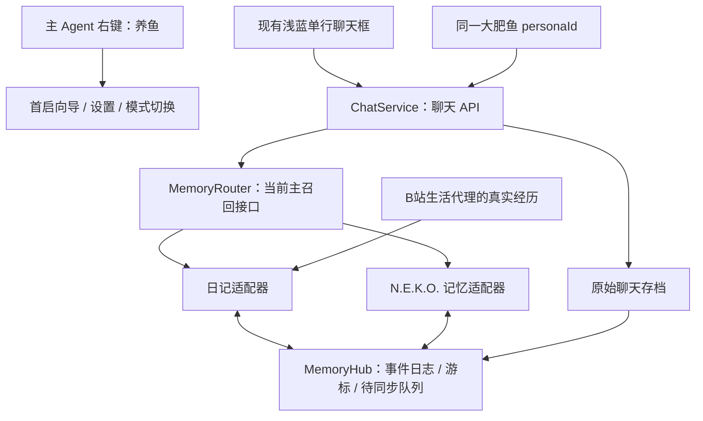

# N.E.K.O. 轻量版：双记忆与一键养鱼 v2

本轮更新框架、接口、右键菜单和同步参考内核。真实 N.E.K.O. / dsh-bili-whale 适配与下载即用安装包仍需按验收表开发，不把接口草案或模拟测试当成已上线功能。

## 用户看到的入口

全部配置统一放在**右键主 Agent → 养鱼**。入口按需打开小型设置窗口，桌面继续保留人物、单行聊天框与气泡。

```text
右键主 Agent
└─ 养鱼
   ├─ 一键开始养鱼…       初次打开配置向导，配置完成后直接恢复养鱼
   ├─ 暂停养鱼            暂停主动生活，不停止用户在 DSH 发起的任务
   ├─ 记忆方式
   │  ├─ 日记模式（轻量）  默认
   │  └─ N.E.K.O. 记忆（进阶）
   ├─ 两边自动同步         开关，只有已配置的接口参与
   ├─ 立即同步
   ├─ 同步状态 / 处理冲突…
   ├─ 养鱼设置…           聊天 API、人设、N.E.K.O. 连接、B站扫码与作息
   └─ 记忆与日记…         原始聊天、两本日记、记忆编辑、备份与恢复
```

子 Agent 的菜单继续负责自己的常驻、昵称和任务操作。主角色仅随自己的聊天改变状态。同步、B站生活代理与 DSH 子任务不会把主角色变成工作状态。

## 两个接口，一份角色身份

角色固定使用内部 `personaId=bigfish`，显示名、人设、桌宠皮肤分别管理。切换记忆方式或皮肤，不创建一条新鱼，不重置聊天、关系或日记。

| 接口 | 主召回能力 | 本机数据 |
|---|---|---|
| `WhaleDiaryMemoryAdapter` | 从聊天、日记和明确记忆条目中按预算取回内容 | 保留原始日记；新增独立的条目 ID / 来源 / 修订侧表 |
| `NekoMemoryAdapter` | 调用 N.E.K.O. 的事实、反思、关系与检索能力 | 保留 N.E.K.O. 原生存储、内部 ID 与索引 |

记忆模式选择的是**本次聊天主要用谁召回**。后台可以同步双方，但不为一条聊天同时调用两套召回并重复计费。聊天 API 和记忆接口分别配置：第一版主角色仍可直接连接聊天 API。



MemoryHub 是同步协调记录，不接管或覆盖两边的原生存储。日记原文继续作为故事和经历，N.E.K.O. 内部反思与索引继续由原系统维护。

## 两边同步什么

**可交换内容**：同一角色的真实经历、用户偏好、可确认事实、带来源的摘要、用户修正、明确删除记录，以及已关联的音频转写引用。

**保留各自原生形态**：N.E.K.O. 的索引、向量缓存、反思内部状态，日记的段落排版与文学表达。把摘要写入另一端时标记为“同步摘要”，不能伪装成新发生的经历或逐字原话。

**不进入记忆同步**：账号凭据、Cookie、API 密钥、DSH 会话权限、其他角色的记忆、B站发送额度和整个内部提示词。人物设定属于 PersonaStore，另有用户控制的配置同步，不从日记推测后自动改写。

每个交换事件包含：`eventId`、`itemId`、`personaId`、来源系统与原始记录 ID、前置修订 ID、操作类型、事件时间、可见范围和确认来源。反思被算法确认，不等于用户亲口确认，必须保留两者区别。

## 双向同步规则

1. **增量与去重**：通过来源 ID、事件 ID 和游标处理新增或变化。镜像事件保留原 ID，不因另一端再次导出就变成新经历。
2. **离线续传**：先把事件和待同步任务可靠落盘，再报告本地保存成功；目标接口离线时保留队列，不丢弃记忆、不改主召回方式。
3. **冲突保留双方**：同一条记忆被两边独立修改时保存两个分支，不单按电脑时间覆盖。用户可以从“同步状态 / 处理冲突”选择或合并。
4. **删除有记录**：使用 tombstone 删除事件传播。旧日记再次扫描不能把已删除记忆悄悄复活。恢复必须是一次明确的恢复操作。
5. **私人内容保持私人**：给用户的日记与私人日记分别存储。私人条目只能进入具备私有存储能力的同角色目标；不能被自动改写进公开日记、B站评论或通知正文。
6. **不自动扩散**：同步不会发送 B站私信或评论。养鱼模式与对外发布是不同设置。
7. **可追溯**：结构化记忆指向原始聊天、视频 ID 或日记段落；找不到来源时保留“来源缺失”状态，不补造证据。

对旧的自由文本日记，首次导入按文件、段落、内容指纹建立侧表，默认作为经历或候选记忆。单纯更换标点不能重复创造大量事实；无法判断的编辑差异进入待处理区。新增的机器管理区使用稳定 ID，人工原文仍保留。

## 一键切换方式

右键选择目标模式 → 检查目标连接与角色映射 → 保存恢复点 → 将截至本次操作的事件同步到目标 → 确认没有阻断冲突 → 原子更新主召回接口。

目标未安装、离线、协议不兼容、保存失败或同步未完成时，继续使用原模式。界面显示“仍在使用日记模式，N.E.K.O. 待连接”等具体状态，不假装切换成功。切换期间的新聊天排入本地队列；已运行的 DSH 任务继续。

“两边自动同步”默认开启，但未连接的可选接口只显示待连接。用户关闭它时，本地存档与记忆照常保存；再次开启后从检查点补齐。

## 一键开始养鱼

首次向导只收集必要信息：

1. 选择预设“大肥鱼”或编辑人设；创建稳定角色 ID。
2. 使用已有的聊天 API 配置或支持的账号登录；需要新密钥时只填写一次。
3. 默认采用本地日记模式，不要求先安装整套 N.E.K.O.。
4. 可选：连接已有 N.E.K.O. 记忆服务，再启用双向同步。
5. 可选：启用 B站生活模块时扫码登录、选择兴趣和作息。默认先浏览与记日记；对外发送由独立设置控制。
6. 点击“开始养鱼”，以后同一入口直接恢复；无需用户手工找目录、改 JSON 或运行命令。

安装器需捆绑桌面运行时、日记适配器与所需 DSH 组件，并提供可选 N.E.K.O. 组件。首次账号/API 配置是必要前提；“下载即可养鱼”不表示无需账号、无需网络或无需任何模型费用。

## 现有仓库的接入边界

- dsh-bili-whale 当前通过专用 DSH 会话、人设文件、两本日记和事件日志维持连续性。原格式没有本框架的统一修订协议，需由适配器补充侧表、事件去重与删除标记。
- N.E.K.O. 已有记忆管理和外部 Markdown 导入代码。现有接口可以作为接入基础；统一导出游标、幂等写入、私有范围与删除传播仍需版本协商和真实验证，不能把“可导入 Markdown”视为完整双向同步。
- 每个适配器必须声明 `pull/push/idempotency/tombstone/privateMemory` 等能力。缺少必要能力时显示“需要适配组件”，不能偷偷直接改写活跃的 `facts.json`、反思文件或索引。
- 本框架的标准协议是新增的产品内协议，不声称两个上游已经原生支持。

参考来源：[dsh-bili-whale 会话恢复](https://github.com/Alterssss/dsh-bili-whale/blob/main/lib/session-delivery.js)、[日记与事件](https://github.com/Alterssss/dsh-bili-whale/blob/main/tools/commands/diary.mjs)、[N.E.K.O. 记忆路由](https://github.com/Project-N-E-K-O/N.E.K.O/blob/main/main_routers/memory_router.py)、[外部 Markdown 导入](https://github.com/Project-N-E-K-O/N.E.K.O/blob/main/memory/external_markdown_import.py)。核对日期：2026-10-26。
