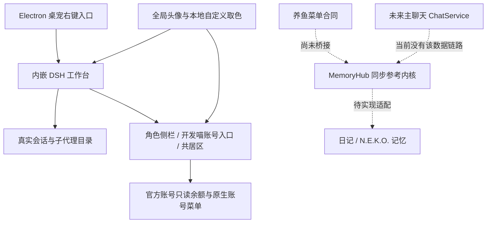

# N.E.K.O. 桌宠工作台项目框架 v3

本文沿用附件路径记法：`desktop/` 在本仓库对应 `apps/neko-workbench/`；`src/`、`config/`、`reference/`、`tests/` 等框架资料对应 `apps/neko-workbench/framework/` 下的同名目录。

v3 合并两条已有工作：`desktop/` 中可在已配置本机环境启动的 Electron v0.13.0 原型，以及 v2 的双记忆接口与同步参考内核。桌宠和工作台已经有 prototype；日记、N.E.K.O. 记忆、通用聊天 API、B站生活向导及“养鱼”控制仍未接到该原型。

本文件描述当前边界与接入方向。保留的 [双记忆与一键养鱼](双记忆与一键养鱼.md)、[接入与发布验收](接入与发布验收.md) 继续作为产品合同；其中的向导、自动同步及分发目标不因此变成已交付功能。

## 产品与身份

N.E.K.O. 是主品牌。大肥鱼是稳定的陪伴角色，也有同名外观；这两个概念分别存储。内部人设与记忆空间保留 `personaId=bigfish`，不得由可见名字、头像或 DSH 会话生成。

| 身份或配置 | 负责什么 | 不能改变什么 |
|---|---|---|
| `personaId=bigfish` | 人设、关系和未来记忆命名空间 | 不随改名、换肤或切 DSH 会话变化 |
| `skinId` / 素材包 | 外观、颜色与动作 | 不创建角色，不重置聊天与记忆 |
| 工作台角色位 `yui / bigfish / claude` | 侧栏显示名、头像及入口可用性 | 不自动创建另一套人设、账号或模型后端 |
| 工作台全局头像 | 全 UI 配色与自定义头像显示 | 不更改账号登录、角色位或 `personaId` |
| DeepSeek 官方账号 | 官方认证、原生钱包余额和原生账号动作 | 不把凭据交给角色配置或记忆同步 |
| DSH `sessionId` | 当前工作台与真实子代理任务路由 | 不是大肥鱼的记忆空间，也不是角色 ID |
| 桌宠内部 actor `main` | 当前主桌宠窗口和 UI 状态 | 将来映射 `bigfish` 时仍须显式桥接，不能把 actor ID 当记忆 ID |

本轮角色位固定为 Yui、大肥鱼、Claude小姐，可自定义名字与头像。只有 `bigfish` 启用现有真实 DSH 工作台入口；另两位显示未接入。不得通过配置或界面外观声称另两套后端已经启用。

## 当前结构



图中的 DSH 工作入口不表示主桌宠聊天可以直接布置任务。主角色仍与 DSH 工作状态分离；任务由用户在内嵌 DSH 或对应真实子代理入口发起。

## 模块与完成范围

| 模块 | v3 当前内容 | 后续工作 |
|---|---|---|
| PetShell / AvatarRenderer | 透明人物窗口、拖动、点击、悬停、右键、原 dsh-pet 动作与反馈原型 | 在目标机器验证；PNGTuber 未实现 |
| DshBridge | 真实会话路由、子代理目录、常驻、昵称、停止、显示上限与工作台入口 | 随官方运行时版本复核 |
| 工作台角色配置 | 固定三个角色位，名字与头像自定义；仅大肥鱼启用 | 其他角色需独立产品与后端接入，不靠 UI 解锁 |
| 工作台原生工具 | 插件、自动化、More 收在大肥鱼入口，复用原生动作 | 不改写任务权限或自动执行 |
| AccountHabitat | 开发喵名字在头像上方；右侧真实原币种余额、独立底色生活区及一只原版大肥鱼 | 余额失败、退出、重登录等由原账号状态驱动 |
| AvatarTheme | 五套头像背景及本地 custom 取色，全局 token 联动 | 不影响角色、人设、账号或会话 |
| MainChat / ChatApiAdapter | 通用聊天 API 仍为合同；原型有可选本机 N.E.K.O. 传输代码和设置入口 | 完成独立 ChatService、预算、持久聊天与真实 API 验收 |
| PersonaStore / ConversationStore | v2 类型与 `bigfish` 人设示例保留 | 尚未作为完整独立服务挂到桌面原型 |
| MemoryService / MemoryRouter | 类型合同与切换要求保留 | 实现召回、确认、编辑、摘要和主聊天接入 |
| MemoryHub | 可执行同步协调参考内核与原模拟测试 | 接可靠持久化及真实 diary/neko adapters |
| 日记 / N.E.K.O. / B站 / VoiceMemory | 合同、映射与验收目标 | 不在本轮启动、登录或真实联调 |

`desktop/main.cjs` 当前的 `state.memory` 经“任务备注”窗口保存本地文字，供任务上下文使用。它没有接入 `MemoryHub`，不能称为双记忆、独立人格记忆或 N.E.K.O. 记忆服务。

## 现有交互保留

- 桌面常驻人物，沿用原 dsh-pet 尺寸与动作；不恢复被取消的常驻姓名条或单字徽标。工作台侧栏的角色名字属于另一层 UI。
- 主角色点击打开单行输入，气泡与完整回复入口保留。通用聊天 API 尚未实现；可选 N.E.K.O. 连接也不自动拥有双记忆能力。
- 主角色右键保留工作台、设置、任务备注及可选连接入口。新的“养鱼”集合见配置合同，尚未挂到运行中的记忆 hub。
- 子代理来自 DSH 真实目录，按真实顺序、常驻与显示上限管理，默认上限 5；常驻、昵称、恢复 DSH 名称、停止及原版完成/错误反馈继续使用现有实现。
- 子代理消息继续路由到自身 DSH 会话；悬停保留任务、工作内容和上一条用户消息。主角色不因子代理工作而进入工作状态。
- 账号菜单保留原登录、充值、设置及其他原生动作；只读余额与人物呈现不替代官方账号管理。

## 余额与共居区

开发喵是账号入口的固定显示身份，名字在主头像上方；它不等于 `personaId=devcat`，也不表示为开发喵新建账号。

当前 DeepSeek 官方账号对应一只原版 dsh-pet 大肥鱼，住在有独立底色的共同区域内，不各自加圆框，也不散布到整个按钮。人物复用原始 idle 动作与透明 poster；余额位于人物区域上方。角色呈现依据真实账号状态，不把 Yui、Claude小姐等尚未接入角色位当作已登录账号。

钱包经官方只读接口读取，显示其原有 CNY 或 USD 币种；不做汇率换算，不把不同钱包相加，不把读取失败或未登录伪装为余额为零。独立框架预览中的示例额度与真实工作台余额必须明确区分。

全局工作台头像驱动背景：Yui、开发喵、大肥鱼、Claude、Gemini，以及本地 custom 取色。主题通过 `data-neko-avatar-theme` 和颜色 token 传播，共居区使用 `--neko-account-habitat-bg`；主题变化不得改变账号或会话。

## 双记忆目标保持

两个记忆接口仍共享同一 `personaId=bigfish`：日记适配器保留原文和修订侧表，N.E.K.O. 适配器保留原生 ID、反思与索引。主召回只选择一个来源，后台同步不重复召回或重复计费。

记忆继续分为近期原始聊天、用户确认的事实/偏好、带来源消息 ID 的摘要；模型推测先作为候选。换皮肤、改名字、换记忆模式均不重置原始聊天、关系或日记。其他角色经历、凭据、DSH 权限不进入大肥鱼的记忆空间。

未来主聊天的数据链路为：用户输入 → 固定人设 → 当前记忆适配器召回 → 预算内近期聊天 → ChatProvider → 流式回复 → 原始对话存档 → 候选记忆或摘要。此链路是接入目标，当前桌面原型尚未贯通。

具体桥接位置与验收见 [工作台与共居区整合](工作台与共居区整合.md)。不得用任务备注、可选 N.E.K.O. WebSocket 连接或模拟同步测试替代真实记忆服务联通的证明。

## 包内目录与运行数据

```text
框架根目录/
  desktop/                         # Electron v0.13.0 原型源码，不含本机运行数据
    main.cjs / workbench-preload.cjs
    workbench-roles.cjs / workbench-appearance.cjs
    embedded-dsh/                  # UI 扩展、主题、角色与账号共居区
    assets/ / original/            # 原版桌宠素材与反馈逻辑
    启动NEKO工作台.command
  src/contracts.ts                 # 原 v2 类型合同
  src/memory-contracts.ts           # 双记忆适配器协议
  src/workbench-contracts.ts        # v3 工作台与共居区合同
  reference/memory-hub.mjs          # 同步参考内核
  tests/memory-hub.test.mjs          # 原离线测试
  config/                          # 人设、皮肤、工作台、养鱼菜单与应用配置示例
  docs/                            # 当前整合说明及保留的产品合同
  distribution/manifest.example.json
```

`desktop/data/`、`desktop/runtime/`、`desktop/workspaces/` 和真实账号余额截图不随本源码包携带。程序正常运行后会在本地创建自己的运行数据；官方账号凭据继续由官方 DSH 管理。

未来角色存储、聊天数据库、日记、事件库和恢复点应独立于桌宠 UI 状态。系统钥匙串与 `${APP_DATA}/personas/bigfish/` 等路径仍是产品合同，不表示本包已经提供完整密钥或记忆存储实现。

## 接入与发布顺序

1. 在依赖齐备的本机验证现有桌宠、DSH、账号与主题，确认本轮 UI 整合未改变原会话和任务功能。
2. 按原合同接主进程持久化与 diary adapter，默认日记模式先独立可用；随后接 ChatService、ConversationStore 与 MemoryRouter。
3. 将“养鱼”菜单映射到受限控制接口，未连接的功能显示待接入，不预先启动 N.E.K.O. 或 B站。
4. 为目标 N.E.K.O. 版本实现兼容网关，验证角色隔离、去重、私有记忆、删除、冲突、离线与恢复，完成后才允许真实模式切换。
5. 另行接 B站生活模块、语音记忆和 PNGTuber；对外发布与模型调用均需对应授权，不从旧附件推导。
6. 完成运行时与素材许可、签名、干净机器安装和升级保留数据验收，再制作发行版。

本轮只整合源码、合同与离线测试，不启动真实 N.E.K.O.、B站或模型任务。官方 Electron 与 DSH 是当前原型的本机依赖，未随包提供，不能宣称“下载即用”。
