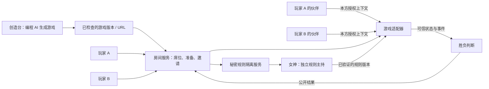

# Nekofans 游戏世界：架构与流程设计

状态：设计稿，2026-11-09。首轮验证为两名玩家、各一名 AI 伙伴、国际象棋切片；平台协议不限定棋类。现有独立链接房间是本地流程预览，不等于已接通以下全部功能。

## 产品定位与角色

- **创造台**：由发布者选择的 DeepSeek 或其他编程 AI 按要求生成、修改游戏，并经检查后提供游戏链接。它不等同于玩家的大肥鱼。
- **玩家与伙伴**：每人使用自己的席位和自己选择的主 Agent。大肥鱼是所属玩家的队友，只能收到公开信息及该玩家允许她知道的本方信息。
- **女神**：独立的中立规则服务及其模型能力，接收双方秘密要求，检查约定、主持需要的游戏规则变更，并依据双方确认的决胜条件处理胜负。她与任何一方的伙伴不是同一个会话或同一权限。
- **玩家共同约定**：平台固有约束、双方公开的本局条件和双方各自的隐藏规则各有边界。发生无法从既定约定解决的冲突时暂停，由双方决定补充约定；模型不能私自增加胜负标准。

## 玩家流程

1. 发布者在创造台要求编程 AI 制作或修改游戏，取得可访问的游戏链接。
2. 在 Nekofans 选择「创建游戏」，粘贴链接，填写游戏名与本局公开的决胜条件，生成房间。系统显示该链接的接入能力：仅链接、已接入操作同步、已接入可信裁决；不能因有链接就显示已联机。
3. 发布者将**房间邀请链接**分享到聊天室。邀请链接不带席位令牌或私密规则；每位参与者通过自己的账户领取各自席位。
4. 每方只看到自己的隐藏规则输入框，把自己的要求发给女神；内容不进入对方页面、对方 Agent 上下文或发布者的普通工作台。女神处理后，本方可修改自己的要求，直至双方按约定锁定。第一版每方一条，长度上限可配置；不把“十个字”当成固定产品约束。
5. 双方确认相同版本的公开决胜条件；两位玩家和各自已连接的伙伴分别准备。修改规则或公共条件时，撤销受影响的准备并要求重新确认。实际允许真人接管还是由 Agent 行动，应由本局约定，不强制完全自动。
6. 四方均准备且游戏适配器及规则版本已就绪，才启动游戏。两边实时收到各自被授权的游戏画面、公开事件及自己的私密视图。伙伴行动必须提交给游戏服务校验，失败或超时不自动代走。
7. 可信游戏事件触发事先确认的决胜条件，女神主持裁决；若游戏支持“猜中隐藏规则获胜”，应在本局公开条件中明确这一条，而不是给所有游戏默认添加。结果不确定或冲突则暂停、记录原因、等待双方解决。
8. 对局结束展示结果与允许公开的过程；隐藏规则是否揭晓、何时揭晓由本局约定。保留对局回放时也执行同样的信息权限。

## 架构

- **房间服务**保存房间、席位、准备状态、公共条件版本、游戏版本和事件序列；席位权限由服务端鉴权，不依靠前端隐藏字段。
- **秘密规则服务**每方各一条初始规则，单独授权女神和本方伙伴；禁止将对方原文写入普通日志、公共事件、邀请链接或另一方模型上下文。服务器管理者和被授权的模型提供方可能接触数据，不能宣传绝对保密。
- **游戏适配器**定义游戏标识及版本、玩家视图、允许的操作、规则修改、游戏状态和可信结果事件。服务端核对席位、回合、状态版本、规则版本和操作合法性。客户端或嵌入页面自称“我赢了”不可直接视作可信结果。
- **女神服务**应使用独立身份、模型会话和数据访问策略。生成的代码不得直接获得房间服务、服务器凭证或双方秘密；规则修改需要受限表示、隔离执行、校验与版本锁定。表达不清或不能验证时需要说明并等待双方处理。
- **执行与展示隔离**：未经检查的 AI 游戏作为不可信代码处理；显示外部网页仅在明确授权和安全隔离下进行。页面消息按来源和权限校验；不让第三方页面读取席位凭证或规则。
- **外链能力分级**：普通 URL 可用于分享和跳转，但无法凭空赋予实时联机、控制隐藏规则或读取胜负；只有实现并通过 Nekofans 适配协议的游戏才能提供相应能力。无法验证的第三方结果应保持待确认。

## 胜负判断：女神与 Jev

优先将双方确认的胜负条件表达为可执行、版本化的判断，并基于受信任适配器输出的状态/事件确定结果。女神可以用模型将自然语言翻译成**候选**条件、解释冲突或给出需要澄清的问题；候选结果经验证并按本局约定确认后才生效。无法结构化、证据不足或规则冲突时进入“待双方决定”，不臆断。

Jev 可作为非强制的独立辅助，用于对脱敏的有限选项做分类或一致性提示；它不是权威游戏执行器。外部决策服务涉及额外费用、延迟和数据发送；未明确授权和建立合适数据边界前，不向其发送双方隐藏规则、账号或可识别信息。判断模型是否更好，应比较有标准答案的测试集上的准确率、冲突识别率、延迟和成本，不能只凭单次示例决定。

## GitHub / 官方文档参考

| 项目 | 可参考的部分 | 边界与建议 |
| --- | --- | --- |
| [Colyseus](https://github.com/colyseus/colyseus) | 实时房间、多人状态同步；[StateView](https://docs.colyseus.io/state/view) 提供按客户端控制视图的机制。 | 可作为今后跨玩法房间层候选；需自己定义并测试秘密视图、可信游戏适配器和女神权限。 |
| [boardgame.io](https://github.com/boardgameio/boardgame.io) | 回合制游戏状态、联网，以及 [playerView 私密视图](https://boardgame.io/documentation/secret-state.html)。 | 适合参考国际象棋试验；它要求游戏接入对应模型，不能作为整个未来多游戏产品的唯一约束。 |
| [Nakama](https://github.com/heroiclabs/nakama) | 账号、多人房间和[服务端权威对局](https://heroiclabs.com/docs/nakama/concepts/multiplayer/authoritative/)。 | 功能更全面，但需要额外服务及运维；先验证小规模玩法，再按实际需求评估迁移。 |
| [OpenSpiel](https://github.com/google-deepmind/open_spiel) | 不完全信息博弈、多 Agent 和策略研究的环境及算法。 | 用作研究或测试参考，不是现成的聊天室联机与托管平台。 |

以上项目均不能单独实现“任何 AI 生成的外链自动安全联机、理解任意私密规则并可靠判胜”。引用或移植代码前逐一核查许可证、维护状态和具体版本。

## 首个可验收切片

1. **界面与身份**：在现有工作台完成链接建房、聊天室邀请、两用户独立入席，区分外链和已接入游戏。
2. **隐私与准备**：各方提交/修改本方一条规则；两名真人和两个独立账号的伙伴就绪；逐项验证网络响应、日志、模型上下文与普通工作台不暴露对方秘密。
3. **女神与游戏**：只支持首个已接入的国际象棋版本与有限可校验规则；女神调用和伙伴调用采用独立账号能力与会话，无法理解的规则不能伪装为成功应用。
4. **裁决与恢复**：双方确认版本化的获胜条件，受信任事件驱动结果；验证断线、重复请求、超时、状态版本冲突、规则冲突及人类接管。
5. **真实验证**：先本机真实双客户端，再验证两个独立账号和完整对局；之后才做香港服务器和朋友间联机测试。任何录制素材需标明真实操作、模拟或概念演绎。

## 当前已具备与未完成

现有 `link-room-service.mjs` 和 `link-room-preview.html` 验证了本机链接建房、双席规则输入和准备状态的基础流程，属于单独预览，重启即丢失；它未接入日常版工作台、实际 AI 伙伴、游戏同步、女神裁决、聊天室分享或香港服务器。真实对局和录制由另一协作任务单独推进，结果以该任务的实测为准。
